# Screamsheet Component Architecture & Multi-Stage Refactoring Plan

## 1. Executive Summary & Architectural Vision

Currently, `screamsheet` is organized around monolithic sheet classes (e.g., `SportsScreamsheet`, `NewsScreamsheet`, `PresidentialScreamsheet`) that instantiate data providers, coordinate team resolution or LLM processors, and pass raw data into generic `Section` renderers that use `if/elif` column-sniffing to decide how to draw tables.

**Target Architecture:**
1. **Self-Contained Screamsheet Components**: Every section becomes a subclass of `ScreamsheetComponent` (which inherits from `Section` for backward compatibility) that owns its own configuration, data fetching, LLM summarization (if any), PDF rendering, Markdown rendering, and layout sizing metadata.
2. **Clean Class Hierarchies (SRP & Open/Closed Principle)**:
   - Top-level abstract component families (`StandingsComponent`, `GameScoresComponent`, `BoxScoreComponent`, `TVScheduleComponent`, `NewsStoryComponent`, etc.) with clean sport- or topic-specific subclasses.
   - Zero column-sniffing `if/elif` chains inside renderers. Adding a new league (e.g., `LaLigaStandingsComponent`) or news source requires only a small subclass and provider.
3. **Pre-Established Templates**: All existing screamsheets remain at their current import paths as lightweight template configurations that assemble a specific list of components and generate identically to today.
4. **Custom Component Screamsheets & Layout Engine**: A `CustomScreamsheet` composer takes any ordered list of components from a `ScreamsheetOrder` / subscriber YAML (with optional `screamsheet_title`, defaulting to `"Screamsheet"`) and formats them cleanly across 1, 2, or $N$ pages in exact YAML order.

---

## 2. Code Review Findings (Current Pain Points to Resolve)

1. **SRP Violations in `src/screamsheet/renderers/standings.py` (`StandingsSection`)**:
   - Inspects DataFrame column names at runtime (`if 'conference' in self.data.columns and 'GP' in ...`) to branch into `_render_nhl_standings`, `_render_nfl_standings`, `_render_nba_standings`, `_render_mlb_standings`, and `_render_generic_standings`, while `WorldCupStandingsSection` lives in a separate file.
2. **SRP Violations & External Coupling in `src/screamsheet/renderers/box_score.py` (`BoxScoreSection`)**:
   - Sniffs dictionary keys (`batting_stats`, `skater_table`, `player_stats`, `away_linescores`) to dispatch sport-specific table builders.
   - Coupled to `SportsScreamsheet._resolve_featured_team`, which resolves the featured team outside the section before constructing it.
   - Bundles the LLM `GameSummary` (left column) and `BoxScore` (right column) without encapsulating team resolution.
3. **Leaky `src/screamsheet/base/data_provider.py` (`DataProvider`) Interface**:
   - Forces news RSS providers (`MLBNewsRssProvider`, `PoliticalRSSProvider`, `WhiteHouseProvider`, `PoliticalNewsProvider`, `NHLNewsRssProvider`, `MLBTradeRumorsProvider`, `NFLNewsProvider`, `FrenchMLBScraperProvider`, etc.) and sky/astro providers to implement dummy `get_game_scores()` and `get_standings()` methods.
4. **Parent-Driven Slicing in `src/screamsheet/renderers/news_articles.py` (`NewsArticlesSection`)**:
   - Parent sheets manually instantiate two separate `NewsArticlesSection` instances (`start_index=0, max_articles=2, page_slot="front"` and `start_index=2, max_articles=2, page_slot="back"`) sharing a single provider instance, and embed day-of broadcast schedules inside `NewsArticlesSection` or `GameScoresSection` rather than as an extensible component.
5. **Hardcoded 2-Page Bucket Layout in `src/screamsheet/base/screamsheet.py` (`BaseScreamsheet`)**:
   - Only supports `page_slot == "front"` and `page_slot == "back"`. Cannot flow or pack an arbitrary ordered list of components or multi-page article streams across 2 or more pages.

---

## 3. Provider & Component Class Hierarchies

### 3.1 DataProvider Hierarchy (`src/screamsheet/base/data_provider.py`)
- **`DataProvider` (Root Base Class)**:
  - Stores `self.config`, provides text/HTML sanitization helpers (`_sanitize_text`, `_looks_like_garbage`, `sanitize_entry`, `sanitize_articles`), and provides safe default no-op implementations for `get_game_scores()`, `get_standings()`, `get_box_score()`, `get_game_summary()`, `has_game()`, `get_all_teams_for_date()`, and `get_day_schedule()` so non-sports providers and existing tests never break.
- **`SportsDataProvider(DataProvider)`**:
  - Declares `@abstractmethod def get_game_scores(self, date: datetime) -> list` and `@abstractmethod def get_standings(self) -> Any`, plus sports hooks (`get_box_score`, `get_game_summary`, `has_game`, `get_all_teams_for_date`, `get_day_schedule`).
  - Subclassed by `MLBDataProvider`, `NHLDataProvider`, `NBADataProvider`, `NFLDataProvider`, `WorldCup26DataProvider`.
- **`NewsDataProvider(DataProvider)`**:
  - Declares `@abstractmethod def get_articles(self) -> List[Dict]`.
  - Supports optional `exclude_links: Optional[ set[str] ]` / sheet-level deduplication so stories are never duplicated within a screamsheet.
  - Subclassed by `MLBNewsRssProvider`, `NHLNewsRssProvider`, `MLBTradeRumorsProvider`, `NFLNewsProvider`, `PoliticalRSSProvider`, `WhiteHouseProvider`, `PoliticalNewsProvider`, `FrenchMLBScraperProvider`.

### 3.2 Component Hierarchy

```mermaid
classDiagram
    class Section {
        <<abstract>>
        +title: str
        +data: Any
        +page_slot: str
        +fetch_data() void
        +has_content() bool
        +render() list~Flowable~
        +render_markdown() str
    }

    class ScreamsheetComponent {
        <<abstract>>
        +component_key: str
        +title: str
        +layout_spec: ComponentLayoutSpec
        +fetch_data() void
        +has_content() bool
        +render(styles, max_width) list~Flowable~
        +render_markdown() str
    }

    Section <|-- ScreamsheetComponent

    ScreamsheetComponent <|-- StandingsComponent
    StandingsComponent <|-- MLBStandingsComponent
    StandingsComponent <|-- NHLStandingsComponent
    StandingsComponent <|-- NBAStandingsComponent
    StandingsComponent <|-- NFLStandingsComponent
    StandingsComponent <|-- WorldCupStandingsComponent

    ScreamsheetComponent <|-- GameScoresComponent
    GameScoresComponent <|-- MLBGameScoresComponent
    GameScoresComponent <|-- NHLGameScoresComponent
    GameScoresComponent <|-- NBAGameScoresComponent
    GameScoresComponent <|-- NFLGameScoresComponent
    GameScoresComponent <|-- WorldCupGameScoresComponent
    GameScoresComponent <|-- MLBAllStarGameScoresComponent

    ScreamsheetComponent <|-- BoxScoreComponent
    BoxScoreComponent <|-- MLBBoxScoreComponent
    BoxScoreComponent <|-- NHLBoxScoreComponent
    BoxScoreComponent <|-- NBABoxScoreComponent
    BoxScoreComponent <|-- NFLBoxScoreComponent
    BoxScoreComponent <|-- WorldCupBoxScoreComponent
    BoxScoreComponent <|-- MLBAllStarBoxScoreComponent

    ScreamsheetComponent <|-- TVScheduleComponent
    TVScheduleComponent <|-- NFLTVScheduleComponent

    ScreamsheetComponent <|-- NewsStoryComponent
    NewsStoryComponent <|-- PresidentialNewsComponent
    NewsStoryComponent <|-- MLBTradeRumorsComponent
    NewsStoryComponent <|-- MLBNewsComponent
    NewsStoryComponent <|-- NHLNewsComponent
    NewsStoryComponent <|-- NFLNewsComponent
    NewsStoryComponent <|-- FrenchMLBArticlesComponent
    NewsStoryComponent <|-- EmailNewsComponent

    ScreamsheetComponent <|-- WeatherComponent
    ScreamsheetComponent <|-- ZodiacWheelComponent
    ScreamsheetComponent <|-- SkyHighlightsComponent
    ScreamsheetComponent <|-- SkyHoroscopeComponent
    ScreamsheetComponent <|-- AgendaComponent
    ScreamsheetComponent <|-- ImportantEmailsComponent
    ScreamsheetComponent <|-- BriefingBackComponent
    ScreamsheetComponent <|-- XKCDComponent
    ScreamsheetComponent <|-- NFLInjuriesComponent
    ScreamsheetComponent <|-- HomeRunDerbyComponent
    ScreamsheetComponent <|-- FrenchMLBLexiconComponent
```



### Detailed Component Families

#### A. `StandingsComponent` (`src/screamsheet/components/standings/`)
- **`StandingsComponent` (Abstract Base)**:
  - Handles title rendering, shared ReportLab table styling, Markdown table serialization, and side-by-side two-column composite table assembly.
  - Accepts optional `provider: Optional[SportsDataProvider] = None` (defaulting to `self._create_provider()`).
  - **Layout Rule**: `component_family="standings"`, `max_on_front_page=1`, `max_per_page=2`, `weight=0.48`. Only **one** standings chart may be placed on Page 1 (front page); Page 2 and subsequent pages can hold up to **two** standings charts per page. Front page space remaining alongside a single standings chart can still hold scores, weather, TV schedule, or news articles.
- **Concrete Subclasses**:
  - `MLBStandingsComponent` (`component_key: "mlb_standings"`): AL & NL side-by-side grouped by division (`Team`, `W`, `L`, `%`).
  - `NHLStandingsComponent` (`component_key: "nhl_standings"`): Eastern & Western side-by-side grouped by division (`GP`, `W`, `L`, `OTL`, `P`, `PCT`, `GF`, `GA`, `DIFF`, `STRK`).
  - `NBAStandingsComponent` (`component_key: "nba_standings"`): Eastern & Western side-by-side by conference (`W`, `L`, `%`, `GB`, `L10`, `STRK`).
  - `NFLStandingsComponent` (`component_key: "nfl_standings"`): AFC & NFC side-by-side (`W`, `L`, `T`, `%`, `DIFF`, `DIV`).
  - `WorldCupStandingsComponent` (`component_key: "worldcup_standings"`): Multi-group grid (`MP`, `W`, `D`, `L`, `GF`, `GA`, `GD`, `PTS`).
- **Extensibility (e.g., `LaLigaStandingsComponent`)**:
  - Subclass `StandingsComponent`, specify column definitions, and bind `LaLigaDataProvider`.

#### B. `GameScoresComponent` (`src/screamsheet/components/game_scores/`)
- **`GameScoresComponent` (Abstract Base)**:
  - Accepts `favorite_teams: list[TeamEntry]`, `target_date: datetime`, `upcoming_games: list[str] | None = None`, and optional `provider: Optional[SportsDataProvider] = None`.
  - Renders the 3-column game score grid (`scores_left`, `scores_center`, `scores_right`) with playoff series badges and optional upcoming broadcast notes.
- **Concrete Subclasses**:
  - `MLBGameScoresComponent` (`"mlb_game_scores"`)
  - `NHLGameScoresComponent` (`"nhl_game_scores"`)
  - `NBAGameScoresComponent` (`"nba_game_scores"`)
  - `NFLGameScoresComponent` (`"nfl_game_scores"`)
  - `WorldCupGameScoresComponent` (`"worldcup_game_scores"`)
  - `MLBAllStarGameScoresComponent` (`"mlb_allstar_game_scores"`)

#### C. `BoxScoreComponent` (`src/screamsheet/components/box_score/`)
- **`BoxScoreComponent` (Abstract Base)**:
  - Accepts `favorite_teams: list[TeamEntry]`, `mad_fan: bool = False`, `target_date: datetime`, optional `team_id: int | None = None`, and optional `provider: Optional[SportsDataProvider] = None`.
  - Encapsulates **featured-team resolution** (checking `favorite_teams` in priority order via `provider.has_game()`, falling back to a random team that played on `target_date` via `provider.get_all_teams_for_date()`).
  - Keeps the combined 2-column layout as a single component: LLM Game Summary on the left, sport-specific Box Score tables on the right (with standalone `GameSummaryComponent` retained for special layouts like `MLBAllStarScreamsheet`).
- **Concrete Subclasses**:
  - `MLBBoxScoreComponent` (`"mlb_box_score"`)
  - `NHLBoxScoreComponent` (`"nhl_box_score"`)
  - `NBABoxScoreComponent` (`"nba_box_score"`)
  - `NFLBoxScoreComponent` (`"nfl_box_score"`)
  - `WorldCupBoxScoreComponent` (`"worldcup_box_score"`)
  - `MLBAllStarBoxScoreComponent` (`"mlb_allstar_box_score"`)

#### D. `TVScheduleComponent` (`src/screamsheet/components/tv_schedule/`)
- **`TVScheduleComponent` (Abstract Base)**:
  - Extensible base component for day-of / upcoming TV broadcast schedules (`provider.get_day_schedule(target_date)`).
  - Accepts `favorite_teams: list[TeamEntry]`, `target_date: datetime`, and optional `provider: Optional[SportsDataProvider] = None`.
  - Formats each matchup with broadcast network and time (`Away @ Home: Time ET (Broadcast)`), bolding games involving `favorite_teams`.
  - Designed so future iterations can add `MLBTVScheduleComponent`, `NHLTVScheduleComponent`, `NBATVScheduleComponent`, etc.
- **Concrete Subclass (Initial)**:
  - `NFLTVScheduleComponent` (`"nfl_tv_schedule"`): Wraps `NFLDataProvider.get_day_schedule()`.

#### E. `NewsStoryComponent` (`src/screamsheet/components/news/`)
- **`NewsStoryComponent` (Abstract Base)**:
  - Default `max_articles: int = 4` when not specified.
  - **Column-by-Column & Page-by-Page Article Flow**: Individual articles are rendered as discrete units that fill the **left half (column 1)** first, then overflow to the **right half (column 2)** of the current page, then overflow to the **left half of the next page**, then the **right half of the next page**, and so on (`2 articles` per page-band in 2-column mode, or paired alongside a schedule card when present).
  - **Screamsheet-Wide Story Deduplication**: Every screamsheet maintains a sheet-level `seen_stories: set[str]` (tracking canonical URLs/IDs and topic cluster keys, building on `seen_links` + `TopicClusterer`). Each `NewsStoryComponent` consults and updates the sheet's `seen_stories` set so stories are never duplicated across multiple news components or pages within the same screamsheet.
- **Concrete Subclasses**:
  - `PresidentialNewsComponent` (`"presidential_news"`): Wraps `PoliticalNewsProvider` + `PoliticalNewsSummarizer`.
  - `MLBTradeRumorsComponent` (`"mlb_trade_rumors_news"`): Wraps `MLBTradeRumorsProvider`.
  - `MLBNewsComponent` (`"mlb_news"`): Wraps `MLBNewsRssProvider`.
  - `NHLNewsComponent` (`"nhl_news"`): Wraps `NHLNewsRssProvider`.
  - `NFLNewsComponent` (`"nfl_news"`): Wraps `NFLNewsProvider` + `NFLNewsSummarizer`.
  - `FrenchMLBArticlesComponent` (`"french_mlb_articles"`): Wraps `FrenchMLBContentProvider` (2-column French articles).
  - `EmailNewsComponent` (`"email_news"`): Wraps `GmailNewsProvider` newsletter digest.

#### F. Specialized / One-Off Components (`src/screamsheet/components/specialized/`)
- **Weather**: `WeatherComponent` (`"weather"`) — Forecast for `lat`, `lon`, `location_name` with `show_description: bool = True` (`False` for compact Morning Briefing banner).
- **Sky Tonight**:
  - `ZodiacWheelComponent` (`"zodiac_wheel"`) — Ecliptic zodiac wheel chart.
  - `SkyHighlightsComponent` (`"sky_highlights"`) — Moon phase, visible planets, satellite passes.
  - `SkyHoroscopeComponent` (`"sky_horoscope"`) — Natal/transit wheel + Kepler/Playbook horoscope.
- **Morning Briefing**:
  - `AgendaComponent` (`"agenda"`) — 2-column calendar events, commute times, and Trello tasks (`TwoColumnAgendaSection`).
  - `ImportantEmailsComponent` (`"important_emails"`) — LLM summaries of emails from priority senders.
  - `BriefingBackComponent` (`"briefing_back"`) — Composite 2-column back page combining `EmailNewsComponent` (left, with right-column overflow when `> max_left_news`) and `ImportantEmailsComponent` (right).
  - `XKCDComponent` (`"xkcd"`) — Daily XKCD comic + title/alt text.
- **Other Sports/Language One-Offs**:
  - `NFLInjuriesComponent` (`"nfl_injuries"`) — Priority team injury tables.
  - `HomeRunDerbyComponent` (`"home_run_derby"`) — Derby bracket & round tables.
  - `FrenchMLBLexiconComponent` (`"french_mlb_lexicon"`) — French-English baseball glossary table.

---

## 4. Mapping Existing Screamsheets to Pre-Established Templates

Every existing screamsheet class remains at its current import path for 100% backward compatibility, implemented as a template that assembles components:

| Existing Screamsheet | Page 1 (Front) Components | Page 2 (Back) Components |
| :--- | :--- | :--- |
| `MLBScreamsheet` | `MLBGameScoresComponent`, `MLBStandingsComponent` | `MLBBoxScoreComponent` |
| `NHLScreamsheet` | `NHLGameScoresComponent`, `NHLStandingsComponent` | `NHLBoxScoreComponent` |
| `NBAScreamsheet` | `NBAGameScoresComponent`, `NBAStandingsComponent` | `NBABoxScoreComponent` |
| `NFLScreamsheet` *(Recap / Games Played)* | `NFLGameScoresComponent`, `NFLStandingsComponent` | `NFLBoxScoreComponent` *(or `NFLNewsComponent` + `NFLTVScheduleComponent`)* |
| `NFLScreamsheet` *(Non-Recap Days)* | `NFLStandingsComponent`, `NFLInjuriesComponent` | `NFLNewsComponent` + `NFLTVScheduleComponent` |
| `FIFAWorldCupScreamsheet` | `WorldCupGameScoresComponent`, `WorldCupStandingsComponent` | `WorldCupBoxScoreComponent` |
| `MLBAllStarScreamsheet` | `MLBAllStarGameScoresComponent`, `MLBAllStarSummaryComponent` | `MLBAllStarBoxScoreComponent` |
| `HomeRunDerbyScreamsheet` | `HomeRunDerbyComponent(slot="front")` | `HomeRunDerbyComponent(slot="back")` |
| `PresidentialScreamsheet` | `WeatherComponent` (opt), `PresidentialNewsComponent(0..2)` | `PresidentialNewsComponent(2..4)` |
| `MLBNewsScreamsheet` | `WeatherComponent` (opt), `MLBNewsComponent(0..2)` | `MLBNewsComponent(2..4)` |
| `NHLNewsScreamsheet` | `WeatherComponent` (opt), `NHLNewsComponent(0..2)` | `NHLNewsComponent(2..4)` |
| `MLBTradeRumorsScreamsheet` | `WeatherComponent` (opt), `MLBTradeRumorsComponent(0..2)` | `MLBTradeRumorsComponent(2..4)` |
| `FrenchMLBNewsScreamsheet` | `FrenchMLBArticlesComponent` | `FrenchMLBLexiconComponent` |
| `SkyTonightScreamsheet` | `ZodiacWheelComponent`, `SkyHighlightsComponent` | `SkyHoroscopeComponent` |
| `MorningBriefingScreamsheet` | `WeatherComponent(show_description=False)`, `AgendaComponent`, `XKCDComponent` | `BriefingBackComponent(EmailNewsComponent, ImportantEmailsComponent)` |

---

## 5. Layout & Formatting Engine for Custom Screamsheets

When assembling arbitrary components in user-defined order, the layout engine enforces realistic page geometry and prevents overcrowding.

### How the Layout Composer Works
1. **Component Layout Metadata (`ComponentLayoutSpec`)**:
   - Every component defines a `layout_spec` with:
     - `weight: float` — fraction of a full page height it occupies naturally (e.g., `WeatherComponent = 0.18`, `TVScheduleComponent = 0.18`, `GameScoresComponent = 0.28`, `StandingsComponent = 0.48`, `NewsStoryComponent (per 2-article row) = 0.45`, `BoxScoreComponent = 0.90`).
     - `component_family: str` — e.g., `"standings"`, `"scores"`, `"box_score"`, `"news"`, `"weather"`, `"tv_schedule"`, `"generic"`.
     - `max_on_front_page: int | None` — maximum instances of this `component_family` permitted on Page 1. For `StandingsComponent`, **`max_on_front_page = 1`**.
     - `max_per_page: int | None` — maximum instances of this `component_family` permitted on Page 2+ (for `StandingsComponent`, **`max_per_page = 2`**).
     - `renders_own_header: bool` and `preferred_top_divider: bool`.
2. **Front Page vs. Subsequent Page Capacity**:
   - **Page 1 (Front Page)** includes the masthead (`screamsheet_title`, optional subtitle, date banner), so its available vertical weight budget is `0.85` ( reserving `0.15` for the masthead), and **at most 1 `StandingsComponent`** can be placed on Page 1. Other components (such as `GameScoresComponent`, `WeatherComponent`, `TVScheduleComponent`, or a 2-article row of `NewsStoryComponent`) can share Page 1 with that single standings table as long as total weight fits within `0.85`.
   - **Page 2+ (Back Page and beyond)** have full vertical capacity (`1.0`) and can hold up to **2 `StandingsComponent`s** (`0.48 + 0.48 = 0.96 <= 1.0`).
3. **News Article Left-to-Right, Page-to-Page Overflow**:
   - A `NewsStoryComponent` (default `max_articles = 4`) streams articles left-column first, then right-column, and if additional articles remain (or if Page 1 only has vertical space for 1 row of 2 articles), automatically continues the remaining articles onto the next page's left column, then right column.
4. **Per-Page `KeepInFrame` Safety Net**:
   - Each page's assembled flowables are wrapped in `KeepInFrame(maxWidth=0, maxHeight=frame_h, mode="shrink")` so slightly tall tables scale cleanly to fit their page without spilling onto an unintended extra sheet.

---

## 6. Subscriber YAML Schema (`screamsheet-subscribers`)

In the final stage, a subscriber YAML in `screamsheet-subscribers` can request both pre-established templates and custom component screamsheets. Any sheet entry containing `components:` is treated as a custom screamsheet, and supports `screamsheet_title` (replacing the default `"Screamsheet"` masthead title):

```yaml
name: Peter Martinson
email: peter.j.martinson@gmail.com
destination: print

location:
  name: "Bryn Mawr, PA"
  lat: 40.02
  lon: -75.34

sheets:
  # 1. Pre-established templates continue to work identically:
  presidential: true

  # 2. Custom component-based screamsheets (order in YAML = order on page):
  daily_standings:
    screamsheet_title: "Daily Pro Sports Standings"
    components:
      - type: mlb_game_scores
      - type: mlb_standings
      - type: nhl_standings
      - type: nba_standings

  my_custom_digest:
    screamsheet_title: "Peter's Custom Digest"
    components:
      - type: weather
      - type: nfl_tv_schedule
        teams: ["Philadelphia Eagles", "Green Bay Packers"]
      - type: mlb_trade_rumors_news
        teams: ["Milwaukee Brewers", "Philadelphia Phillies"]
        max_articles: 4
      - type: nhl_box_score
        teams: ["Philadelphia Flyers"]
        mad_fan: true
```

---

## 7. Multi-Stage Walking Skeleton Plan

All work proceeds directly from `master` (ignoring old unmerged branches). Each stage ends with a clean state where all existing and new unit tests pass and all existing screamsheets generate identically to today.

### Stage 1: Foundation — `ScreamsheetComponent` Base, Registry, & Provider Cleanup
- **Goal**: Establish the core component abstractions and clean up provider interfaces without breaking any existing sheets or tests.
- **Changes**:
  - Update `src/screamsheet/base/data_provider.py` to provide safe default implementations on `DataProvider` and introduce `SportsDataProvider(DataProvider)` and `NewsDataProvider(DataProvider)`.
  - Update sports providers to inherit from `SportsDataProvider` and news providers to inherit from `NewsDataProvider` (removing redundant `get_game_scores` / `get_standings` stubs from news providers while keeping 100% test compatibility).
  - Create `src/screamsheet/components/base.py` defining `ComponentLayoutSpec` and `ScreamsheetComponent` (subclassing `Section` with `render(self, styles=None, max_width=None)`).
  - Create `src/screamsheet/components/registry.py` (`ComponentRegistry`) to register and instantiate components by `component_key`.
  - Add unit tests in `tests/test_components_foundation.py`.

### Stage 2: Walking Skeleton — `StandingsComponent` Hierarchy & Custom Multi-Page Standings Proof
- **Goal**: Build the complete `StandingsComponent` hierarchy, replace `StandingsSection` and `WorldCupStandingsSection`, and prove the walking skeleton with `CustomScreamsheet` enforcing the "max 1 standings on Page 1, up to 2 standings on Page 2+" rule.
- **Changes**:
  - Create `src/screamsheet/components/standings/` (`StandingsComponent`, `MLBStandingsComponent`, `NHLStandingsComponent`, `NBAStandingsComponent`, `NFLStandingsComponent`, `WorldCupStandingsComponent`).
  - Update sports screamsheets to use the new sport-specific `StandingsComponent` subclasses while keeping `StandingsSection` as a backward-compatible facade/dispatcher for any existing direct callers in tests.
  - Introduce `CustomScreamsheet` (with `screamsheet_title: str = "Screamsheet"`) and $N$-page PDF generation support in `BaseScreamsheet._build_multi_page_pdf(pages)`.
  - Add unit tests for every standings component and end-to-end multi-page custom standings sheets.

### Stage 3: Sports Components — `GameScoresComponent`, `BoxScoreComponent`, `TVScheduleComponent`, & Sports Templates
- **Goal**: Convert all remaining sports sections into self-contained components, add the extensible `TVScheduleComponent` (`NFLTVScheduleComponent`), and turn all sports screamsheets into component templates.
- **Changes**:
  - Create `src/screamsheet/components/game_scores/` (`GameScoresComponent` + `MLB`, `NHL`, `NBA`, `NFL`, `WorldCup`, `MLBAllStar` subclasses).
  - Create `src/screamsheet/components/box_score/` (`BoxScoreComponent` with built-in featured-team resolution + `MLB`, `NHL`, `NBA`, `NFL`, `WorldCup`, `MLBAllStar` subclasses).
  - Create `src/screamsheet/components/tv_schedule/` (`TVScheduleComponent`, `NFLTVScheduleComponent`).
  - Create `NFLInjuriesComponent` and `HomeRunDerbyComponent`.
  - Refactor `SportsScreamsheet` and its subclasses to assemble these components as templates.
  - Add unit tests for all new sports components.

### Stage 4: News & Weather Components — `NewsStoryComponent` Hierarchy, Story Deduplication, & News Templates
- **Goal**: Convert all news, political, French MLB, and weather sections into components with left→right→next-page article overflow (default 4 articles) and screamsheet-wide story deduplication.
- **Changes**:
  - Create `src/screamsheet/components/weather.py` (`WeatherComponent`).
  - Create `src/screamsheet/components/news/` (`NewsStoryComponent`, `PresidentialNewsComponent`, `MLBTradeRumorsComponent`, `MLBNewsComponent`, `NHLNewsComponent`, `NFLNewsComponent`, `FrenchMLBArticlesComponent`, `FrenchMLBLexiconComponent`).
  - Add screamsheet-wide story deduplication tracking (`seen_story_keys: set[str]`) so stories are never duplicated across components or pages on the same screamsheet.
  - Refactor `PresidentialScreamsheet`, `MLBNewsScreamsheet`, `NHLNewsScreamsheet`, `MLBTradeRumorsScreamsheet`, and `FrenchMLBNewsScreamsheet` into component templates.
  - Add unit tests for `WeatherComponent`, `NewsStoryComponent` overflow, and deduplication.

### Stage 5: Sky Tonight & Morning Briefing One-Off Components
- **Goal**: Convert all remaining one-off sections (Sky Tonight & Morning Briefing) into components.
- **Changes**:
  - Create `src/screamsheet/components/sky/` (`ZodiacWheelComponent`, `SkyHighlightsComponent`, `SkyHoroscopeComponent`).
  - Create `src/screamsheet/components/briefing/` (`AgendaComponent`, `ImportantEmailsComponent`, `EmailNewsComponent`, `BriefingBackComponent`, `XKCDComponent`).
  - Refactor `SkyTonightScreamsheet` and `MorningBriefingScreamsheet` into component templates (preserving `XKCDComponent` on Page 1 and `BriefingBackComponent` 2-column overflow on Page 2).
  - Keep `src/screamsheet/renderers/` exports intact for backward compatibility and verify the full test suite.

### Stage 6: Multi-Page Layout & Adjacent Component Formatting Polish
- **Goal**: Polish `CustomScreamsheet` layout composition when mixing arbitrary components (e.g., weather + scores + 1 standings on Page 1, 2 standings on Page 2, overflowing news stories across pages).
- **Changes**:
  - Refine inter-component dividers, headers, and multi-page news continuation headers in `CustomScreamsheet`.
  - Add comprehensive layout unit tests covering mixed component combinations, front-page 1-standings limit, back-page 2-standings packing, and multi-page news overflow.

### Stage 7: `ScreamsheetOrder` & `screamsheet-subscribers` YAML Integration
- **Goal**: Enable end-to-end custom screamsheet definition via `ScreamsheetOrder` and subscriber YAML files.
- **Changes**:
  - Add `ComponentSpec` and `CustomSheetOrderOptions` (with `screamsheet_title: str = "Screamsheet"`) to `order.py` and `custom_sheets: list[CustomSheetOrderOptions]` on `ScreamsheetOrder`.
  - Update `runner.py` to build and execute custom component screamsheets alongside pre-established template orders.
  - Update `screamsheet-subscribers` (`mapper.py` and `manifest.py`) to parse any sheet block containing `components:` (and optional `screamsheet_title`) in exact YAML order.
  - Add unit and integration tests.
